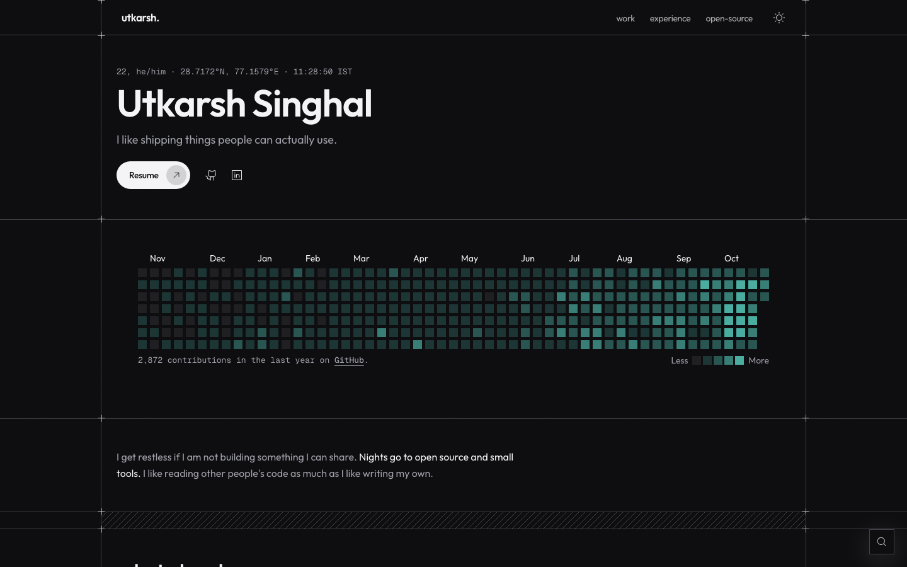

# [utkarsh-singhal.is-a.dev](https://utkarsh-singhal.is-a.dev)

Personal portfolio of Utkarsh Singhal, a backend-leaning full-stack developer: shipped work, experience, open source contributions, and writing.

[](https://utkarsh-singhal.is-a.dev)

## Stack

- [Next.js](https://nextjs.org) (App Router) with React 19 and TypeScript
- Tailwind CSS v4, Base UI, `cmdk` command menu, `next-themes` (light/dark)
- Framer Motion, GSAP and Matter.js for motion
- Open source and contribution data fetched from the GitHub API and cached daily
- Vercel Analytics, Speed Insights and (opt-in, consent-gated) Microsoft Clarity

## Run locally

Requires Node 22+ and Yarn 1.

```bash
yarn install
cp .env.sample .env.local
yarn dev
```

Open http://localhost:3000. Both variables below are optional locally:

| Variable                 | Purpose                                                                |
| ------------------------ | ---------------------------------------------------------------------- |
| `GITHUB_TOKEN`           | Raises the GitHub API rate limit for the open source section           |
| `NEXT_PUBLIC_CLARITY_ID` | Enables Microsoft Clarity (production only, behind the consent banner) |

## Scripts

| Command                     | What it does                                                            |
| --------------------------- | ----------------------------------------------------------------------- |
| `yarn dev`                  | Start the dev server                                                    |
| `yarn build` / `yarn start` | Production build / serve it                                             |
| `yarn lint`                 | Lint with Vite+ (oxlint)                                                |
| `yarn type:check`           | TypeScript via `vp check` (run after a build so `next-env.d.ts` exists) |
| `yarn format:check`         | Format check with Vite+ (oxfmt)                                         |

Site content (profile, projects, experience, links) lives in [`src/app/data.ts`](src/app/data.ts).

## License

The **code** is MIT licensed, see [LICENSE](./LICENSE). You're free to use it as a starting point.

The **content** (text, résumé, images, project write-ups, and my name and likeness) is © Utkarsh Singhal, all rights reserved. Please replace all of it with your own before publishing your site.

## Sponsor

Found this useful? [Sponsor me](https://github.com/sponsors/Utkarsh-Singhal-26).
