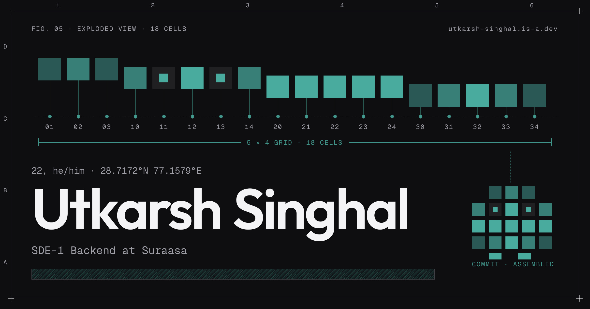

# [utkarsh-singhal.is-a.dev](https://utkarsh-singhal.is-a.dev)

Personal portfolio of Utkarsh Singhal, a backend-leaning full-stack developer: shipped work, experience, open source contributions, and writing. It is also readable by agents: every page has a Markdown twin and the site serves a small read-only API. The switch at the bottom of every page (or the `v` key) shows the Markdown an agent receives for the page you are on.

[](https://utkarsh-singhal.is-a.dev)

## Stack

- [Next.js](https://nextjs.org) (App Router) with React 19 and TypeScript
- Tailwind CSS v4, `cmdk` command menu, `next-themes` (light/dark), and a visitor-selectable accent color (footer row or `⌘K`, saved in `localStorage`)
- Framer Motion, GSAP and Matter.js for motion; two text animations (`DecryptedText`, `SplitFlapText`) are copied from [React Bits](https://reactbits.dev)
- Open source and contribution data fetched from the GitHub API and cached daily; all-time coding time from WakaTime, also cached daily
- A fill-in-the-blank contact form that sends as an email or opens the brief in Claude, ChatGPT or Grok
- Vercel Analytics and Speed Insights, plus consent-gated [PostHog](https://posthog.com) (events, session replay, error tracking, server logs) and Microsoft Clarity; see [Analytics and error tracking](#analytics-and-error-tracking)

## Run locally

Requires Node 22+ and Yarn 1.

```bash
yarn install
cp .env.sample .env
yarn dev
```

Open http://localhost:3000. Every variable below is optional locally:

| Variable                                             | Purpose                                                                                                                    |
| ---------------------------------------------------- | -------------------------------------------------------------------------------------------------------------------------- |
| `GITHUB_TOKEN`                                       | Raises the GitHub API rate limit for the open source section                                                               |
| `NEXT_PUBLIC_CLARITY_ID`                             | Enables Microsoft Clarity (production only, behind the consent banner)                                                     |
| `NEXT_PUBLIC_POSTHOG_KEY`                            | PostHog project token (`phc_...`, safe to expose). Enables client analytics and server logs; production (Vercel) only      |
| `POSTHOG_API_KEY`, `POSTHOG_PROJECT_ID`              | Build-time only, never `NEXT_PUBLIC_`: personal API key (error tracking write access) and project ID for source map upload |
| `UPSTASH_REDIS_REST_URL`, `UPSTASH_REDIS_REST_TOKEN` | Visitor counter (local dev falls back to a file)                                                                           |
| `WAKATIME_OAUTH_TOKEN`                               | All-time coding time on `/activity` (needs a WakaTime OAuth token; the figure is hidden without it)                        |

## Scripts

| Command                     | What it does                                                                    |
| --------------------------- | ------------------------------------------------------------------------------- |
| `yarn dev`                  | Start the dev server                                                            |
| `yarn build` / `yarn start` | Production build / serve it (`postbuild` deletes any `.map` files from `.next`) |
| `yarn lint`                 | Lint with Vite+ (oxlint)                                                        |
| `yarn type:check`           | TypeScript (run after a build so `next-env.d.ts` exists)                        |
| `yarn format:check`         | Format check with Vite+ (oxfmt)                                                 |

Site content (profile, projects, experience, links) lives in [`src/content/data.ts`](src/content/data.ts). The FAQ, contact guide, API endpoint list and privacy text sit beside it in `src/content/`. The UI, the Markdown pages, the JSON API, the OpenAPI spec and the JSON-LD all read from these files, so a fact is written once.

## Pages and agent endpoints

| Route                              | What it is                                                                                      |
| ---------------------------------- | ----------------------------------------------------------------------------------------------- |
| `/`                                | Home: work, experience, open source, stack, writing, FAQ, contact                               |
| `/developers`                      | The API, with live responses you can tab through                                                |
| `/activity`                        | GitHub contributions (this year against last, as two rings) and WakaTime coding time, as charts |
| `/resume`, `/resume.pdf`           | Resume page; the PDF is proxied from Drive, inline or `?download=1`                             |
| `/privacy`                         | Privacy and cookie policy                                                                       |
| `/index.md`, `/developers.md`, ... | Markdown twin of every page (`/resume.md`, `/activity.md`, `/privacy.md`)                       |
| `/llms.txt`, `/llms-full.txt`      | Plain-text summary and the full version                                                         |
| `/api/v1`                          | Read-only JSON: `profile`, `experience`, `projects`, `skills`                                   |
| `/openapi.json`                    | OpenAPI 3.1 description of the API                                                              |
| `/.well-known/ai-catalog.json`     | Every machine-readable resource                                                                 |
| `/.well-known/api-catalog`         | RFC 9727 API catalog                                                                            |
| `/auth.md`                         | Authentication: none, everything is public and read-only                                        |

The five pages also answer `Accept: text/markdown` on their own URL (rewrites and `Vary: Accept` in [`next.config.ts`](next.config.ts)), and each HTML page links its twin with `rel="alternate"`.

## Keyboard shortcuts

Single keys work anywhere except in a text field; `?` shows the same list in the site.

| Key             | Does                                                 |
| --------------- | ---------------------------------------------------- |
| `h`             | Home                                                 |
| `w` `e` `o` `c` | Jump to Work, Experience, Open source, Contact       |
| `d` `a` `r` `p` | Developers, Activity, Resume, Privacy policy         |
| `t`             | Toggle theme                                         |
| `v`             | Toggle human / agent view                            |
| `k`             | Cookie settings (when the consent banner is enabled) |
| `⌘K`, `/`       | Open the command menu                                |
| `?`, `esc`      | Show shortcuts, close the menu or help               |

## Project layout

```
src/
  instrumentation.ts    server error logs to PostHog (OpenTelemetry), production only
  app/                  routes only (pages, layout, OG images, sitemap, robots, llms*.txt, .md twins, api/v1, openapi.json, .well-known)
  content/
    data.ts             profile, projects, experience, skill groups and the SITE_URL constant
    api.ts              ENDPOINTS: one list feeding the API index, OpenAPI, catalog and Developers page
    faq.ts, contact.ts, privacy.ts   FAQ, contact guidance and privacy text
  components/
    ui/                 small reusable building blocks (includes the React Bits `decrypted-text` and `split-flap-text`)
    layout/             site shell, navbar, footer
    sections/           one file per page section
    features/           self-contained widgets (command menu, mascot, loader, route transition, human/agent view, cursor, ...)
    kibo-ui/            vendored component
  lib/
    accent.ts           accent names and their rendered hex codes (hue/saturation/lightness live in globals.css)
    agent/              Markdown generators, JSON API payloads and the OpenAPI/catalog builders
    github/             GitHub data fetching and the activity stats (cached daily)
    analytics.ts        typed event schema and the track() / trackHref() helpers
    json-ld.ts          schema.org graph for the layout
    page-metadata.ts    title, description, canonical and social tags for a page
    wakatime.ts         WakaTime all-time stats (cached daily)
    og/                 Open Graph card: an exploded view of the cell mascot (the image at the top of this file)
```

## Analytics and error tracking

Everything below runs only on Vercel (`VERCEL_ENV` set) and only when its variable is set, so local runs send nothing. The consent banner is also shown in development so it can be tested.

**Consent.** PostHog starts opted out (`opt_out_capturing_by_default`, `opt_out_persistence_by_default`): no events are captured and no `ph_*` cookies or visitor IDs are written until the visitor accepts the banner. Clarity's script is not loaded until then; turning analytics off later reloads the page so it stops. [`consent-banner.tsx`](src/components/features/consent-banner.tsx) calls `posthog.opt_in_capturing()` / `opt_out_capturing()` and the Clarity consent API when the choice changes, and the footer "cookies" button reopens it. What each tool stores is listed once in [`src/content/storage.ts`](src/content/storage.ts), which feeds both the banner and the privacy page.

**What PostHog gives you** (all through `posthog-js`, set up in [`posthog.tsx`](src/components/features/posthog.tsx)):

| Feature                 | How                                                                                                                                                                                            |
| ----------------------- | ---------------------------------------------------------------------------------------------------------------------------------------------------------------------------------------------- |
| Web analytics           | `defaults: "2026-08-30"` sends `$pageview` on every client-side route change and `$pageleave` when a page is left                                                                              |
| Autocapture, web vitals | On by default; toggled in PostHog project settings                                                                                                                                             |
| Session replay          | Inputs masked; switched on in PostHog Settings → Session replay                                                                                                                                |
| Error tracking          | `capture_exceptions: true` reports uncaught errors and unhandled rejections                                                                                                                    |
| Server logs             | [`src/instrumentation.ts`](src/instrumentation.ts) sends unhandled server errors (message, path, method) to PostHog Logs over OpenTelemetry. Not consent-gated, so it never logs personal data |

**Custom events.** All named events are typed in [`src/lib/analytics.ts`](src/lib/analytics.ts) (`snake_case`, `object_action`), so a typo fails the build. Components call `track()` or `trackHref()`, never PostHog directly.

| Event                             | Fired when                                                               |
| --------------------------------- | ------------------------------------------------------------------------ |
| `resume_clicked`                  | A link or command menu action opens `/resume.pdf` (`download`, `via`)    |
| `contact_clicked`                 | A `mailto:` link or the command menu email action is used                |
| `outbound_clicked`                | Any external link is clicked (`host`, `url` without query string, `via`) |
| `command_menu_opened`             | The command menu opens                                                   |
| `theme_changed`, `accent_changed` | The visitor changes theme or accent                                      |
| `view_changed`                    | The human / agent view is switched                                       |
| `copy_clicked`                    | A copy button is used                                                    |

To add one, add it to the `Events` type in `analytics.ts` and call `track("name", props)`. Keep properties free of personal data.

**Reverse proxy.** The browser talks to `/ingest/*`, which [`next.config.ts`](next.config.ts) rewrites to PostHog's US hosts (`us.i.posthog.com`, `us-assets.i.posthog.com`), so ad blockers drop fewer events and the CSP stays at `'self'`. `skipTrailingSlashRedirect` is on because PostHog API paths end in a slash. For EU cloud, change the three hosts and `ui_host`.

**Source maps.** With `POSTHOG_API_KEY` and `POSTHOG_PROJECT_ID` set (in Vercel, Production), `withPostHogConfig` generates source maps during `yarn build`, uploads them to PostHog so stack traces are readable, and deletes them. The `postbuild` script then removes any `.map` left in `.next`, so readable source is never served. Builds without the two variables skip the upload and still ship no maps. `productionBrowserSourceMaps` stays `false`.

**Checking it works.** After a deploy with the key set, accept the banner and open the PostHog project: Activity → Events shows pageviews and the events above, Session replay shows the visit, and Logs shows server errors. Use the real domain to filter out local test traffic, and delete test persons (with events and recordings) from People before launch.

## Security notes

- Security headers, including the Content-Security-Policy, are set in [`next.config.ts`](next.config.ts).
- `WAKATIME_OAUTH_TOKEN` is read server-side only and never sent to the browser.
- `NEXT_PUBLIC_POSTHOG_KEY` is a write-only project token and is meant to be public. `POSTHOG_API_KEY` is a personal key: set it only as a build-time variable in Vercel, never with a `NEXT_PUBLIC_` prefix.
- Source maps are uploaded to PostHog and deleted before deploy (see above), so the production bundle does not expose readable source.
- `GITHUB_TOKEN` only needs read access to public data: use a fine-grained token with no extra permissions.

## License

The **code** is MIT licensed, see [LICENSE](./LICENSE). You're free to use it as a starting point.

The **content** (text, résumé, images, project write-ups, and my name and likeness) is © Utkarsh Singhal, all rights reserved. Please replace all of it with your own before publishing your site.

## Sponsor

Found this useful? [Sponsor me](https://github.com/sponsors/Utkarsh-Singhal-26).
