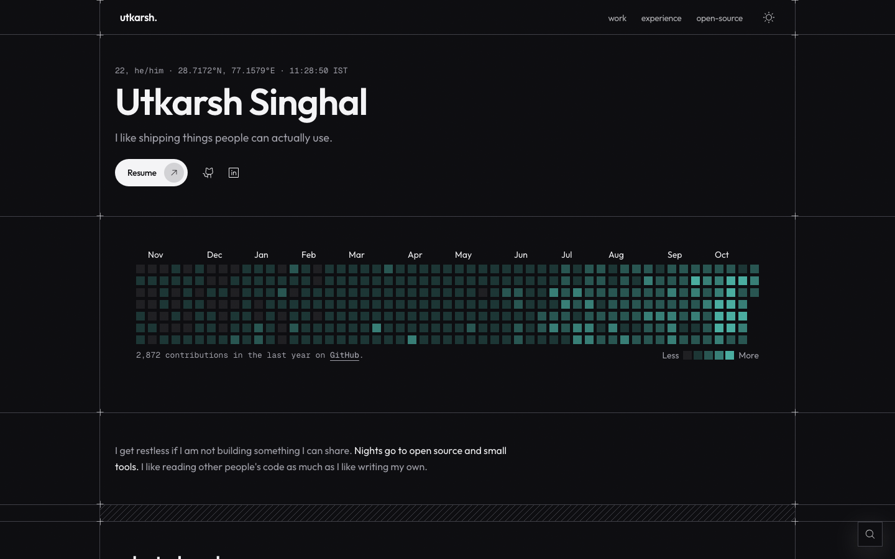

# [utkarsh-singhal.is-a.dev](https://utkarsh-singhal.is-a.dev)

Personal portfolio of Utkarsh Singhal, a backend-leaning full-stack developer: shipped work, experience, open source contributions, and writing. It is also readable by agents: every page has a Markdown twin and the site serves a small read-only API. The switch at the bottom of every page (or the `v` key) shows the Markdown an agent receives for the page you are on.

[](https://utkarsh-singhal.is-a.dev)

## Stack

- [Next.js](https://nextjs.org) (App Router) with React 19 and TypeScript
- Tailwind CSS v4, `cmdk` command menu, `next-themes` (light/dark), and a visitor-selectable accent color (footer row or `⌘K`, saved in `localStorage`)
- Framer Motion, GSAP and Matter.js for motion; two text animations (`DecryptedText`, `SplitFlapText`) are copied from [React Bits](https://reactbits.dev)
- Open source and contribution data fetched from the GitHub API and cached daily; all-time coding time from WakaTime, also cached daily
- A fill-in-the-blank contact form that sends as an email or opens the brief in Claude, ChatGPT or Grok
- Vercel Analytics, Speed Insights and (opt-in, consent-gated) Microsoft Clarity

## Run locally

Requires Node 22+ and Yarn 1.

```bash
yarn install
cp .env.sample .env
yarn dev
```

Open http://localhost:3000. Every variable below is optional locally:

| Variable                 | Purpose                                                                                             |
| ------------------------ | --------------------------------------------------------------------------------------------------- |
| `GITHUB_TOKEN`           | Raises the GitHub API rate limit for the open source section                                        |
| `NEXT_PUBLIC_CLARITY_ID` | Enables Microsoft Clarity (production only, behind the consent banner)                              |
| `NEXT_PUBLIC_GA_ID`      | Enables Google Analytics 4 (production only, Consent Mode v2: storage denied until accepted)        |
| `WAKATIME_OAUTH_TOKEN`   | All-time coding time on `/activity` (needs a WakaTime OAuth token; the figure is hidden without it) |

## Scripts

| Command                     | What it does                                             |
| --------------------------- | -------------------------------------------------------- |
| `yarn dev`                  | Start the dev server                                     |
| `yarn build` / `yarn start` | Production build / serve it                              |
| `yarn lint`                 | Lint with Vite+ (oxlint)                                 |
| `yarn type:check`           | TypeScript (run after a build so `next-env.d.ts` exists) |
| `yarn format:check`         | Format check with Vite+ (oxfmt)                          |

Site content (profile, projects, experience, links) lives in [`src/content/data.ts`](src/content/data.ts). The FAQ, contact guide, API endpoint list and privacy text sit beside it in `src/content/`. The UI, the Markdown pages, the JSON API, the OpenAPI spec and the JSON-LD all read from these files, so a fact is written once.

## Pages and agent endpoints

| Route                              | What it is                                                                                      |
| ---------------------------------- | ----------------------------------------------------------------------------------------------- |
| `/`                                | Home: work, experience, open source, stack, writing, FAQ, contact                               |
| `/developers`                      | The API, with live responses you can tab through                                                |
| `/activity`                        | GitHub contributions (this year against last, as two rings) and WakaTime coding time, as charts |
| `/resume`, `/resume.pdf`           | Resume page; the PDF is proxied from Drive, inline or `?download=1`                             |
| `/privacy`                         | Privacy and cookie policy                                                                       |
| `/index.md`, `/developers.md`, ... | Markdown twin of every page (`/resume.md`, `/activity.md`, `/privacy.md`)                       |
| `/llms.txt`, `/llms-full.txt`      | Plain-text summary and the full version                                                         |
| `/api/v1`                          | Read-only JSON: `profile`, `experience`, `projects`, `skills`                                   |
| `/openapi.json`                    | OpenAPI 3.1 description of the API                                                              |
| `/.well-known/ai-catalog.json`     | Every machine-readable resource                                                                 |
| `/.well-known/api-catalog`         | RFC 9727 API catalog                                                                            |
| `/auth.md`                         | Authentication: none, everything is public and read-only                                        |

The five pages also answer `Accept: text/markdown` on their own URL (rewrites and `Vary: Accept` in [`next.config.ts`](next.config.ts)), and each HTML page links its twin with `rel="alternate"`.

## Keyboard shortcuts

Single keys work anywhere except in a text field; `?` shows the same list in the site.

| Key             | Does                                                 |
| --------------- | ---------------------------------------------------- |
| `h`             | Home                                                 |
| `w` `e` `o` `c` | Jump to Work, Experience, Open source, Contact       |
| `d` `a` `r` `p` | Developers, Activity, Resume, Privacy policy         |
| `t`             | Toggle theme                                         |
| `v`             | Toggle human / agent view                            |
| `k`             | Cookie settings (when the consent banner is enabled) |
| `⌘K`, `/`       | Open the command menu                                |
| `?`, `esc`      | Show shortcuts, close the menu or help               |

## Project layout

```
src/
  app/                  routes only (pages, layout, OG images, sitemap, robots, llms*.txt, .md twins, api/v1, openapi.json, .well-known)
  content/
    data.ts             profile, projects, experience, skill groups and the SITE_URL constant
    api.ts              ENDPOINTS: one list feeding the API index, OpenAPI, catalog and Developers page
    faq.ts, contact.ts, privacy.ts   FAQ, contact guidance and privacy text
  components/
    ui/                 small reusable building blocks (includes the React Bits `decrypted-text` and `split-flap-text`)
    layout/             site shell, navbar, footer
    sections/           one file per page section
    features/           self-contained widgets (command menu, mascot, loader, route transition, human/agent view, cursor, ...)
    kibo-ui/            vendored component
  lib/
    accent.ts           accent names and their rendered hex codes (hue/saturation/lightness live in globals.css)
    agent/              Markdown generators, JSON API payloads and the OpenAPI/catalog builders
    github/             GitHub data fetching and the activity stats (cached daily)
    json-ld.ts          schema.org graph for the layout
    wakatime.ts         WakaTime all-time stats (cached daily)
    og/                 Open Graph image rendering
```

## Security notes

- Security headers, including the Content-Security-Policy, are set in [`next.config.ts`](next.config.ts).
- `WAKATIME_OAUTH_TOKEN` is read server-side only and never sent to the browser.
- `GITHUB_TOKEN` only needs read access to public data: use a fine-grained token with no extra permissions.
- `yarn audit` reports advisories against `vite`. They are false positives: `vite` here is an alias for `@voidzero-dev/vite-plus-core`, and the audit matches its version number against old Vite releases.

## License

The **code** is MIT licensed, see [LICENSE](./LICENSE). You're free to use it as a starting point.

The **content** (text, résumé, images, project write-ups, and my name and likeness) is © Utkarsh Singhal, all rights reserved. Please replace all of it with your own before publishing your site.

## Sponsor

Found this useful? [Sponsor me](https://github.com/sponsors/Utkarsh-Singhal-26).
